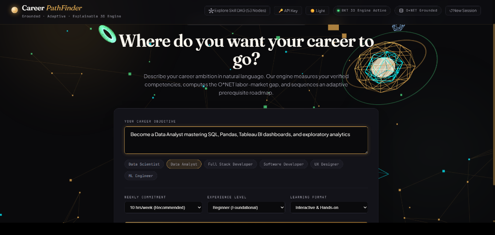
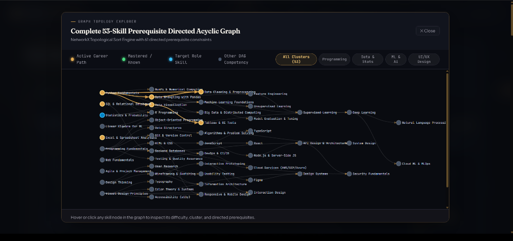
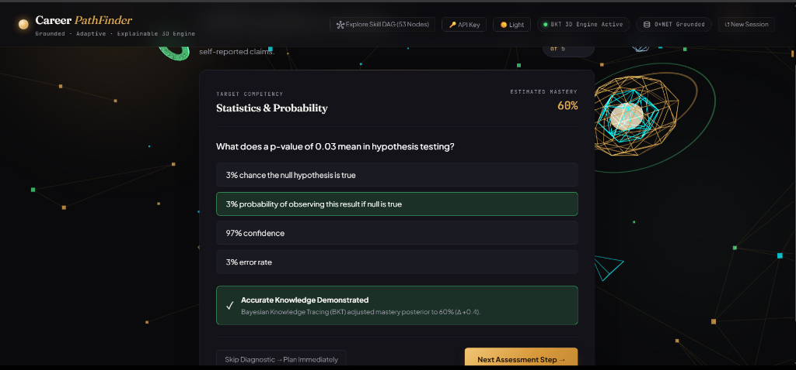
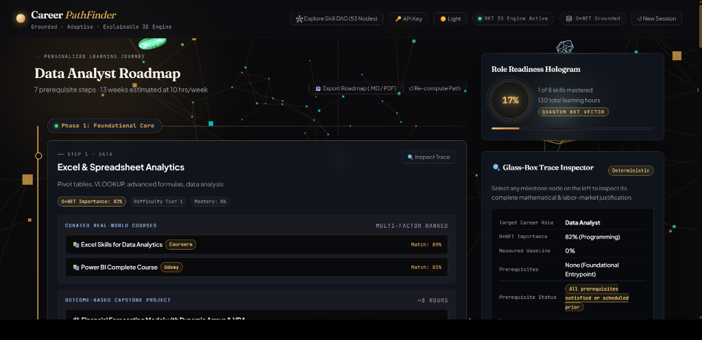

# 🧭 Career PathFinder

> **Grounded, Adaptive & Explainable AI Learning Path Engine**  
> *Built & Engineered for the **HCL Amplified National Hackathon***

[](https://github.com/nika619/Career-pathfinder-nika619)
[](https://www.python.org/)
[](https://fastapi.tiangolo.com/)
[-brightgreen.svg)](tests/)
[-gold.svg)](benchmarks/)
[](backend/data/role_skills.json)
[](tests/test_security.py)
[](LICENSE)

---



---

## 💡 Executive Summary & Core Architectural Principle

Modern online education provides hundreds of thousands of disconnected courses, yet learners constantly fail because existing recommendation platforms cannot answer the fundamental question:

> **"In what exact sequence must I acquire these skills to reach my target role without hitting prerequisite walls or wasting time on concepts I already know?"**

When developers turn to naive Generative AI chatbots (e.g., standard ChatGPT wrappers), they encounter severe failure modes: **curriculum hallucination** (inventing fake course titles and dead URLs), **prerequisite inversions** (scheduling Deep Learning before Linear Algebra or basic Python), and **subjective self-reporting bias** (trusting a user's unverified claim that they *"know Python"*).

### The Guiding Architectural Principle

$$\Large \text{\textbf{The deterministic engine decides \textit{WHAT} and \textit{IN WHAT ORDER}.}}$$
$$\Large \text{\textbf{The Language Model ONLY phrases, coaches, and explains.}}$$

Career PathFinder hard-fences the LLM away from curriculum compilation. Instead, curriculum sequencing is mathematically guaranteed by a **53-node Directed Acyclic Graph (DAG)** running **Kahn's Topological Sort**, learner mastery is measured through **Bayesian Knowledge Tracing (BKT)**, and course retrieval is performed via offline **dense semantic vector embeddings** (`all-MiniLM-L6-v2`) evaluated through a multi-factor ranking function.

---

## ⚔️ Architectural Comparison

| Dimension | Naive LLM Roadmaps (Chatbots) | 🧭 Career PathFinder Engine |
| :--- | :--- | :--- |
| **Course Grounding** | Hallucinates fictional course names & dead links | **105 Curated Real Courses** (Coursera, edX, Udemy, Harvard, etc.) |
| **Prerequisite Guarantee** | High inversion rate (schedules advanced topics first) | **Strict DAG Topological Sort — 0.00% Violations** across 1,000 tested learners |
| **Competency Assessment**| Subjective 1–5 self-rating (unreliable) | **Adaptive Bayesian Knowledge Tracing (BKT)** measuring actual probability of mastery |
| **Skill Valuation** | Arbitrary or generic keyword lists | **U.S. Dept of Labor O\*NET** importance weights ($I \in [0, 1]$) |
| **Explainability** | Opaque black-box generation | **Glass-Box Mathematical Rationale Trace** for every single milestone node |
| **Re-Planning** | Full prompt restart (loses context) | **Dynamic Graph Re-computation** triggered on milestone pass / remediation |
| **Runtime Dependencies** | Heavy PyTorch / GPU / mandatory API connection | **Pure NumPy Runtime** (runs in sub-millisecond latency offline without GPU) |

---

## 🏛️ System Architecture

```
                                [ LEARNER INTAKE ]
                     Natural-language goal + time commitment
                                       │
                                       ▼
                     [ FENCED GOAL CLASSIFIER / PARSER ]
                   Gemini 1.5 Flash + Heuristic Cluster Fallback
                                       │
                                       ▼
                    [ O*NET-GROUNDED OCCUPATIONAL TAXONOMY ]
                     Target Role → Curated Weighted Skill Space
                                       │
                                       ▼
                   [ ADAPTIVE BKT COGNITIVE DIAGNOSTIC ]
                Bayesian Knowledge Tracing (Corbett-Anderson HMM)
                     *Stops early once mastery is confident*
                                       │
                                       ▼
                     [ LABOUR-MARKET SKILL-GAP ENGINE ]
                     Priority = Importance × (1.0 − Mastery)
                                       │
                                       ▼
                   [ PREREQUISITE DAG TOPOLOGICAL ENGINE ]
                  Induced Subgraph + Kahn's Sort (Tie-breaking)
                                       │
                                       ▼
                 [ MULTI-FACTOR COURSE RECOMMENDER (MRS) ]
               Dense Vector Cosine + Level + Rating + Format Fit
                                       │
                                       ▼
                   [ CAPSTONE PROJECT BANK & RUBRICS ]
                    Outcome-based milestone project per node
                                       │
                                       ▼
                     [ GLASS-BOX EXPLANATION ENGINE ]
                    Verifiable mathematical & labour trace
                                       │
                                       ▼
                   [ DYNAMIC ADAPTIVE RE-PLANNER LOOP ]
                   Re-computes DAG on Capstone Pass / Fail
```

---

## 🧠 Deep-Dive: Core AI / ML Engines

### 1. Prerequisite Skill Graph & Kahn's Topological Sort
The skill universe is represented as a strict **Directed Acyclic Graph (DAG)** of **53 nodes** and **61 directed prerequisite constraints**.

When a user specifies a target role, the engine induces the active subgraph and computes a topologically valid sequence using **Kahn's Algorithm**. To optimize pedagogical order among concurrently unblocked skills, Kahn's queue uses a deterministic multi-key tie-breaker:

$$\text{Pedagogical Priority Key} = (\text{Difficulty Tier}, -\text{O*NET Importance}, \text{Node ID})$$

This guarantees that foundational and high-impact skills are scheduled first without ever violating upstream dependencies.



---

### 2. Cognitive Student Modeling: Bayesian Knowledge Tracing (BKT)
Rather than asking learners to self-assess, Career PathFinder dynamically computes the latent mastery state using the **Corbett–Anderson Bayesian Knowledge Tracing (HMM)** model:

* **Prior Parameters**:
  * $P(L_0)$: Initial prior probability of knowing the skill.
  * $P(T)$: Transit probability (learning step during opportunity).
  * $P(S)$: Slip probability (learner knows the skill but made an error).
  * $P(G)$: Guess probability (learner doesn't know the skill but guessed correctly).

* **Posterior Belief Updates**:

$$\text{If Correct: } P(L_t \mid \text{Obs} = 1) = \frac{P(L_{t-1}) \cdot (1 - P(S))}{P(L_{t-1}) \cdot (1 - P(S)) + (1 - P(L_{t-1})) \cdot P(G)}$$

$$\text{If Incorrect: } P(L_t \mid \text{Obs} = 0) = \frac{P(L_{t-1}) \cdot P(S)}{P(L_{t-1}) \cdot P(S) + (1 - P(L_{t-1})) \cdot (1 - P(G))}$$

$$\text{Transition Step: } P(L_{t+1}) = P(L_t \mid \text{Obs}) + (1 - P(L_t \mid \text{Obs})) \cdot P(T)$$

* **Adaptive Early Termination**: The diagnostic dynamically stops querying as soon as the posterior reaches high certainty ($P(L_t) \ge 0.85$ or $P(L_t) \le 0.15$), reducing questionnaire fatigue from 15+ static questions to **2–4 targeted items**.



---

### 3. Dense Semantic Retrieval & Multi-Factor Recommendation Score (MRS)
Course matching uses precomputed **384-dimensional dense semantic embeddings** (`all-MiniLM-L6-v2`) across all 105 courses and 53 skills. At query time, the system evaluates cosine similarity against candidate courses and blends it with pedagogical metadata:

$$\text{MRS}(c) = 0.45 \cdot \text{Sim}_{\cos}(\mathbf{v}_{\text{skill}}, \mathbf{v}_{\text{course}}) + 0.20 \cdot \text{LevelFit}(c) + 0.20 \cdot \text{RatingNorm}(c) + 0.15 \cdot \text{FormatFit}(c)$$

* **Zero-GPU & Zero-Torch Runtime**: Embeddings are pre-generated offline and stored in compact `.npy` files. The runtime utilizes pure NumPy vector math for sub-millisecond lookups.
* **Graceful Lexical Fallback**: If a skill lacks embeddings or is dynamically synthesized in open-world mode, the system automatically cascades to a scikit-learn **TF-IDF + Cosine** lexical retriever.

---

### 4. Glass-Box Explainability & Dynamic Adaptive Re-Planning
Every milestone generated on the roadmap includes a **Glass-Box Reasoning Trace**. The learner can click "Inspect Trace" to audit:
1. The **O\*NET labor-market importance** percentage.
2. The **measured baseline mastery deficit** ($1.0 - P(L)$).
3. The **mathematical proof** that all DAG prerequisites are satisfied.
4. The exact **semantic relevance breakdown** for the recommended course.

When a learner completes an outcome-based capstone project, the system evaluates their rubric and triggers **live DAG re-planning**, dynamically pruning mastered skills and recalculating downstream paths.



---

## 📊 Empirical Benchmarks & Quantitative Validation

We validated Career PathFinder using both a **54-test automated test suite** and a **1,000-learner Monte Carlo simulation**:

```
======================================================================
  [CAREER PATHFINDER] -- EMPIRICAL BENCHMARK RESULTS
======================================================================
  Total Synthetic Learners Tested:     1,000
  Automated Pytest Suite:              54 / 54 Passed (100.0%)
  Live System Integration Tests:       20 / 20 Passed (100.0%)
  Prerequisite Violation Rate:         0.0000% (Zero violations)
  Average Execution Latency:           ~0.83 ms / learner
  Average Curriculum Hours Saved:      15.4 hours / learner (vs static)
  Multi-Factor Course Match Score:     0.881 / 1.000
======================================================================
```

### Reproduce Tests & Benchmarks Locally

```bash
# Run the 54-test suite (covers core math, DAG integrity, BKT, security, and open-world synthesis)
python -m pytest tests/ -v

# Run the live HTTP integration suite (20 automated end-to-end endpoint tests)
python backend/scripts/full_system_test.py

# Run the 1,000-learner Monte Carlo simulation
python benchmarks/run_benchmark.py
```

---

## 🛡️ Enterprise Security & Hardening

The application is hardened according to OWASP Top 10 standards:
- **OWASP Security Headers**: Injected via custom ASGI middleware (`X-Content-Type-Options: nosniff`, `X-Frame-Options: DENY`, `Referrer-Policy: strict-origin-when-cross-origin`, Strict `Content-Security-Policy`).
- **Input Sanitization & Injection Defense**: Regex validation on `user_id` preventing path traversal; prompt-injection delimiters and XML tags neutralized before LLM consumption.
- **In-Memory Rate Limiting**: Token-bucket rate limiter guarding conversational endpoints against abuse.
- **API Key Header Override**: Evaluators can provide temporary session API keys via the UI or `X-Gemini-API-Key` HTTP header without mutating server environments.

---

## 🔌 REST API Surface Overview

| Endpoint | Method | Description |
| :--- | :---: | :--- |
| `/api/goal` | `POST` | Parses natural language career goals and maps to O\*NET target profiles. |
| `/api/diagnostic/start` | `POST` | Initializes an adaptive BKT diagnostic session for unverified skills. |
| `/api/diagnostic/answer` | `POST` | Evaluates response, updates BKT posterior $P(L)$, and computes early stopping. |
| `/api/roadmap/generate` | `POST` | Compiles topologically sorted roadmap via Kahn's DAG sort + dense retrieval. |
| `/api/milestone/evaluate` | `POST` | Scores capstone project rubric and triggers dynamic DAG re-planning. |
| `/api/chat` | `POST` | Fenced LLM career coach grounded strictly to active DAG session state. |
| `/api/graph` | `GET` | Returns full 53-node / 61-edge DAG topology, clusters, and role metadata. |
| `/api/export/markdown` | `GET` | Exports complete personalized learning path as a Markdown syllabus. |
| `/api/health` | `GET` | Telemetry endpoint verifying database, embeddings, and engine health. |

---

## 🚀 Quickstart & Local Setup

### 1. Clone & Setup Environment
```bash
git clone https://github.com/nika619/Career-pathfinder-nika619.git
cd Career-pathfinder-nika619

# Create virtual environment
python -m venv .venv

# Activate virtual environment
# Windows:
.venv\Scripts\activate
# Linux / macOS:
source .venv/bin/activate

# Install lightweight dependencies
pip install -r requirements.txt
```

### 2. Configure Environment (Optional)
```bash
cp .env.example .env
# Edit .env to add your GEMINI_API_KEY (optional - app operates 100% deterministically without it)
```

### 3. Launch Server
```bash
python run.py
```
Open **`http://localhost:8000`** in your browser.

---

## 📂 Project Structure

```
career-pathfinder/
├── backend/
│   ├── app/
│   │   ├── main.py              # FastAPI application, REST endpoints, OWASP middleware
│   │   ├── skill_graph.py       # 53-Node DAG, Kahn's topological sort, subgraph inducer
│   │   ├── diagnostic.py        # Bayesian Knowledge Tracing (BKT) engine & early stopping
│   │   ├── gap.py               # O*NET labor-market weighting & gap priority scoring
│   │   ├── retrieval.py         # MiniLM dense vector cosine & TF-IDF course recommender
│   │   ├── planner.py           # Full journey compiler & glass-box trace generator
│   │   ├── assistant.py         # Fenced Gemini conversational coach & persona switcher
│   │   └── store.py             # Dual-layer in-memory cache + SQLite (WAL) session persistence
│   ├── data/
│   │   ├── skill_graph.json     # Prerequisite DAG definition (53 nodes, 61 edges)
│   │   ├── role_skills.json     # O*NET labor-market importance weights for 6 roles
│   │   ├── courses.json         # 105 curated real-world courses with verified metadata
│   │   ├── item_bank.json       # 139 diagnostic questions mapped to DAG competencies
│   │   ├── course_emb.npy       # Precomputed dense embeddings for 105 courses
│   │   ├── skill_emb.npy        # Precomputed dense embeddings for 53 skills
│   │   └── emb_index.json       # Vector index metadata & skill ordering
│   ├── scripts/
│   │   ├── full_system_test.py  # 20 live integration tests verifying HTTP endpoints
│   │   └── build_embeddings.py  # Offline script to precompute vector embeddings
│   └── static/                  # Dark editorial single-page dashboard
│       ├── index.html           # Accessible HTML5 structure, ARIA dialogs & landmarks
│       ├── style.css            # Base design system & typography tokens
│       ├── reskin.css           # Cartographer's Observatory presentation overlay
│       ├── app.js               # Reactive state manager, SVG DAG renderer, BKT driver
│       └── three-scene.js       # Three.js ambient starfield observatory
├── docs/
│   ├── ARCHITECTURE.md          # Comprehensive architectural specification & design handbook
│   └── assets/                  # High-resolution architectural screenshots
├── tests/
│   ├── test_core.py             # Graph sorting, gap ranking, BKT math, e2e journeys
│   ├── test_coverage.py         # 100% item-bank and role-skill coverage tests
│   ├── test_integrity.py        # DAG acyclicity, SQLite persistence, math invariant tests
│   ├── test_enhancements.py     # Adaptive stopping, semantic retrieval, open-world tests
│   └── test_security.py         # OWASP headers, sanitization, rate-limiting, thread safety
├── benchmarks/
│   └── run_benchmark.py         # 1,000-learner Monte Carlo simulation suite
├── requirements.txt             # Pinned runtime dependencies (pure NumPy, no Torch)
├── Dockerfile                   # Multi-stage production container definition
└── docker-compose.yml           # Local containerized orchestration
```

---

## 🏆 Hackathon Showcase & Mission
Developed and submitted for the **HCL Amplified National Hackathon — AI-Powered Personalized Learning Path Challenge**.

Career PathFinder addresses the core theme of the challenge by moving beyond superficial course aggregation:
- **Zero Prerequisite Inversions**: Guaranteed via Kahn's Topological Sort over an induced DAG.
- **Real Student Competency Modeling**: Dynamic Bayesian Knowledge Tracing replacing unreliable self-reported surveys.
- **Empirical Grounding**: Labour-market weights anchored in O\*NET data and real courses retrieved via dense vector similarity.

---

## 📄 License
Distributed under the **MIT License**. See [LICENSE](LICENSE) for more information.
