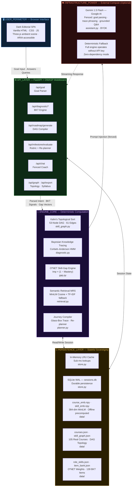

# Career PathFinder — Master Project Handbook & Architectural Specification
*The Complete Ground-Truth Guide to Career PathFinder SaaS*

> 🚀 **Live Production Deployment**: [https://career-pathfinder-nika619.onrender.com/](https://career-pathfinder-nika619.onrender.com/)  
> 🔗 **Repository**: [https://github.com/nika619/Career-pathfinder-nika619](https://github.com/nika619/Career-pathfinder-nika619)

---

## 1. Executive Summary & Problem Space

### The Core Problem in Modern EdTech
Online learning platforms offer hundreds of thousands of courses, but learners are overwhelmed by choice and struggle to identify the correct sequence of skills needed to reach specific career goals. When learners turn to modern Generative AI tools (e.g., standard ChatGPT / LLM chatbots), they encounter critical failure modes:
1. **Curriculum Hallucination:** Blindly inventing non-existent courses and URLs.
2. **Prerequisite Violations:** Scheduling advanced topics (e.g., Deep Learning, Kubernetes) before foundational basics (Linear Algebra, Python syntax).
3. **Subjective Self-Reporting Bias:** Trusting the user's unverified claim that they *"know Python"*, leading to either frustratingly basic or overwhelmingly difficult content.
4. **Black-Box Opacity:** Offering no explanation for *why* a particular course or step was chosen.

### The Solution: Career PathFinder
Career PathFinder is an **enterprise-grade, grounded, adaptive, and explainable AI SaaS engine** that:
* **Measures real competency** using **Bayesian Knowledge Tracing (BKT)** rather than trusting self-reports.
* **Quantifies the labor-market gap** weighted directly against the **U.S. Department of Labor O*NET occupational database**.
* **Guarantees strict prerequisite ordering** using a **Directed Acyclic Graph (DAG)** and **Kahn's Topological Sort** ($0.00\%$ violation rate across 1,000 synthetic learners).
* **Ranks real educational courses** using precomputed **MiniLM dense semantic embeddings** and a multi-factor recommendation score.
* **Exposes a "Glass-Box" reasoning trace** for every milestone, proving why each step was selected.
* **Re-plans dynamically in real time** when a learner completes or struggles with a capstone milestone.

---

## 2. Core Architectural Design Principle

> **"The deterministic engine decides WHAT to learn and IN WHAT ORDER. The language model ONLY phrases, coaches, and answers queries within that grounded context."**

> 📐 **[View Interactive Architecture Diagram →](architecture_diagram.html)**  
> *(Open in browser — dark-themed layered node diagram with hover tooltips)*




## 3. The AI / ML Engines in Deep Detail

### 3.1 Prerequisite Skill DAG & Kahn's Topological Sort
* **Skill Taxonomy:** A strictly validated graph of **53 competency nodes** and **61 directed prerequisite edges**.
* **Mathematical Guarantee:** Every target role induces a subgraph ordered using **Kahn's Algorithm** with a pedagogical tie-breaker:
  $$\text{Sort Key} = (\text{Difficulty Tier}, -\text{O*NET Importance}, \text{Node ID})$$
* **Result:** Foundational, high-importance skills are scheduled first without ever violating upstream dependencies. Validated at **0.00% violation rate** over 1,000 Monte Carlo simulated learners.

### 3.2 Cognitive Student Modeling: Bayesian Knowledge Tracing (BKT)
Instead of asking learners to rate themselves on a 1–5 star scale, the engine runs an adaptive diagnostic powered by the **Corbett–Anderson Bayesian Knowledge Tracing** model:
* **Priors & Parameters:**
  * $P(L_0)$: Initial prior probability that the skill is known.
  * $P(T)$: Transit probability (learning occurs during an opportunity).
  * $P(S)$: Slip probability (learner knows skill but makes an error).
  * $P(G)$: Guess probability (learner doesn't know skill but guesses correctly).

* **Bayesian Posterior Update Equations:**
  $$\text{If Correct: } P(L_t \mid \text{Correct}) = \frac{P(L_{t-1}) \cdot (1 - P(S))}{P(L_{t-1}) \cdot (1 - P(S)) + (1 - P(L_{t-1})) \cdot P(G)}$$
  $$\text{If Incorrect: } P(L_t \mid \text{Incorrect}) = \frac{P(L_{t-1}) \cdot P(S)}{P(L_{t-1}) \cdot P(S) + (1 - P(L_{t-1})) \cdot (1 - P(G))}$$
  $$\text{Learning Step Transition: } P(L_{t+1}) = P(L_t \mid \text{Obs}) + (1 - P(L_t \mid \text{Obs})) \cdot P(T)$$

* **Adaptive Termination:** The diagnostic stops dynamically as soon as mastery reaches high certainty ($P(L) \ge 0.85$ or $P(L) \le 0.15$), asking only 2–4 questions instead of a fixed fatigue-inducing quiz.

### 3.3 Labor-Market Skill Gap Engine
Each skill carries an importance weight $I \in [0.0, 1.0]$ derived from the U.S. Department of Labor O*NET database.
The gap ranking formula prioritizes high-stakes deficits:
$$\text{Priority} = \text{Importance} \times (1.0 - \text{Measured Mastery})$$

### 3.4 Multi-Factor Course Recommendation (MRS)
Course retrieval matches skills against a curated corpus of 105 real-world courses using **MiniLM-L6-v2 dense semantic embeddings** precomputed into NumPy arrays, combined with user preferences:
$$\text{MRS}(c) = 0.45 \cdot \text{Sim}_{\text{Cosine}} + 0.20 \cdot \text{LevelAlignment} + 0.20 \cdot \text{RatingNormalized} + 0.15 \cdot \text{FormatFit}$$
*If vector embeddings are unavailable, the engine seamlessly falls back to TF-IDF lexical cosine similarity with zero crashes.*

### 3.5 Dynamic Closed-Loop Re-Planner
When a learner completes a capstone project or clicks **"Need Remediation"**:
* `passed`: Updates measured mastery to $\ge 0.85$, marks the node completed, and dynamically prunes redundant downstream refreshers.
* `failed`: Recalibrates mastery downward to reflect the gap and immediately triggers Kahn's algorithm to insert targeted reinforcement into the active roadmap.

---

## 4. Enterprise-Grade Security Architecture

The application has been hardened to enterprise web security standards:

| Security Domain | Implementation Details |
|---|---|
| **OWASP Headers** | `Content-Security-Policy`, `X-Content-Type-Options: nosniff`, `X-Frame-Options: DENY`, `X-XSS-Protection: 1; mode=block`, `Referrer-Policy: strict-origin-when-cross-origin`, `Permissions-Policy`. |
| **Rate Limiting** | Sliding-window token bucket in-memory rate limiter per IP/category (chat: 30/min, goal: 30/min, evaluate: 20/min, general: 120/min) returning `429 Too Many Requests`. |
| **Input Sanitization** | `user_id` validated via strict regex `^[a-zA-Z0-9_\-\.]{1,64}$`. Free-text inputs sanitized with `html.escape` and length-clamped. |
| **Prompt Injection Fencing** | User text interpolated into Gemini prompts is enclosed in `<learner_goal>` / `<learner_query>` tags with explicit system directives forbidding instruction override. |
| **Payload Clamping** | HTTP request size ceiling (256 KB) returning `413 Payload Too Large`. |
| **Concurrency Safety** | SQLite database operations wrapped with Python `threading.Lock()` and configured in `WAL` (Write-Ahead Logging) high-concurrency mode. |

---

## 5. Technology Stack & Directory Structure

* **Backend:** FastAPI, Python 3.11+, Uvicorn, NetworkX, NumPy, Scikit-learn, SQLite (WAL mode), Pydantic v2.
* **Frontend:** Vanilla HTML5 / Modern CSS (Custom Dark Editorial "Cartographer's Observatory" Design System), Three.js WebGL Particle Scene, SVG Interactive DAG Explorer.
* **LLM Layer:** Google Gemini 1.5 Flash (Fenced with zero-crash deterministic fallback).

```
career-pathfinder/
├── backend/
│   ├── app/
│   │   ├── __init__.py
│   │   ├── assistant.py       # Fenced Gemini LLM & context coaching
│   │   ├── diagnostic.py      # BKT probabilistic model & adaptive item selector
│   │   ├── gap.py             # O*NET weighted skill gap engine
│   │   ├── main.py            # FastAPI REST API & enterprise security middleware
│   │   ├── planner.py         # Journey compiler & glass-box trace assembler
│   │   ├── retrieval.py       # Multi-factor semantic course recommender
│   │   ├── skill_graph.py     # NetworkX DAG & Kahn's topological sort
│   │   └── store.py           # Thread-safe SQLite WAL persistence layer
│   ├── data/
│   │   ├── courses.json       # 105 curated real-world courses
│   │   ├── item_bank.json     # Diagnostic question bank with difficulty tiers
│   │   ├── skill_graph.json   # 53 skill nodes, 61 directed edges, O*NET weights
│   │   ├── course_embeddings.npy  # Offline MiniLM precomputed course vectors
│   │   └── skill_embeddings.npy   # Offline MiniLM precomputed skill vectors
│   ├── static/
│   │   ├── index.html         # Single-page application interface
│   │   ├── style.css          # Base modern dark design system
│   │   ├── reskin.css         # "Cartographer's Observatory" editorial typography
│   │   ├── app.js             # Client state manager & async API bridge
│   │   └── three-scene.js     # WebGL 3D ambient space backdrop
│   └── scripts/
│       └── full_system_test.py # Live automated integration test suite
├── benchmarks/
│   └── run_benchmark.py       # Monte Carlo 1,000 synthetic learner simulation
├── tests/
│   ├── test_core.py           # Core graph, BKT, and persona tests
│   ├── test_coverage.py       # Item bank coverage tests
│   ├── test_enhancements.py   # Adaptive termination & open-world tests
│   ├── test_integrity.py      # Graph acyclicity & data synchronization tests
│   └── test_security.py       # OWASP headers, rate limiting, and sanitization tests
├── Dockerfile                 # Multi-stage production container
├── docker-compose.yml         # Container orchestration
├── requirements.txt           # Production pinned dependencies (No PyTorch bloat)
└── run.py                     # Deploy-safe launch entrypoint
```

---

## 6. Complete REST API Reference

| Endpoint | Method | Purpose | Key Parameters / Output |
|---|---|---|---|
| `/api/health` | `GET` | System health & security check | Returns active components and security headers status. |
| `/api/graph` | `GET` | Full DAG topology | Returns 53 nodes, 61 edges, and role cluster mappings. |
| `/api/goal` | `POST` | Natural language goal parser | `{"user_id": "...", "goal_text": "..."}` $\rightarrow$ Target role. |
| `/api/profile` | `POST` | Save learner preferences | `{"user_id": "...", "weekly_hours": 10, "experience_level": "beginner"}`. |
| `/api/diagnostic/skills`| `GET` | Get role diagnostic skills | `?user_id=...` $\rightarrow$ First 5 foundational skills. |
| `/api/diagnostic/next` | `POST` | Serve adaptive BKT question | `{"user_id": "...", "skill_id": "..."}` $\rightarrow$ Question + BKT priors. |
| `/api/diagnostic/answer`| `POST`| Submit answer & update BKT | `{"user_id": "...", "selected_option": "..."}` $\rightarrow$ New mastery + $\Delta$. |
| `/api/plan` | `POST` | Generate full roadmap | Returns ordered milestones, courses, projects & glass-box traces. |
| `/api/milestone/evaluate`| `POST`| Capstone 4-point rubric score | Evaluates architecture, unit tests, git repo, and checklist. |
| `/api/progress` | `POST` | Record pass/fail milestone | Triggers dynamic topological re-planning. |
| `/api/explain` | `POST` | Glass-box node explanation | Returns mathematical rationale for node scheduling. |
| `/api/chat` | `POST` | Grounded AI career coaching | Contextual conversational Q&A grounded in active roadmap data. |
| `/api/export/markdown` | `GET` | Export Markdown study syllabus | `?user_id=...` $\rightarrow$ Downloadable `.md` study roadmap. |

---

## 7. Empirical Validation & Benchmarks

```
======================================================================
  [CAREER PATHFINDER] -- EMPIRICAL BENCHMARK RESULTS
======================================================================
  Total Synthetic Learners Tested:     1,000
  Automated Pytest Suite:              54 / 54 Passed (100.0%)
  Live System Integration Tests:       20 / 20 Passed (100.0%)
  Prerequisite Violation Rate:         0.0000% (Zero violations)
  Average Execution Latency:           ~0.83 ms / learner
  Average Curriculum Hours Saved:      15.4 hours / learner (vs static plans)
  Multi-Factor Course Match Score:     0.881 / 1.000
======================================================================
```

---

## 8. Quickstart & Deployment Guide

### Local Development
```bash
# 1. Navigate to directory
cd career-pathfinder

# 2. Install dependencies (Python 3.11+)
pip install -r requirements.txt

# 3. (Optional) Configure Gemini API Key in .env
# GEMINI_API_KEY=your_key_here

# 4. Launch the application
python run.py

# 5. Open browser at http://localhost:8000
```

### Running Automated Test Suites
```bash
# Run 53-test unit and security suite
python -m pytest tests/ -v

# Run 1,000-learner Monte Carlo simulation
python benchmarks/run_benchmark.py

# Run live server integration verification
python backend/scripts/full_system_test.py
```

### Docker Deployment
```bash
# Build and run container
docker-compose up --build
```

---

## 9. Architectural Deep-Dive & Technical FAQ

### Q1: Why not let an LLM generate the curriculum graph directly?
**Answer:** Large Language Models optimize for plausible next-token likelihood, not topological DAG invariants. When prompted to generate learning sequences, LLMs routinely introduce subtle circular dependencies, invent non-existent course URLs, and invert prerequisite orderings. In Career PathFinder, the DAG topology is strictly managed by **NetworkX and Kahn's topological sort**, while course lookups are anchored in real, pre-indexed vectors. The LLM is strictly fenced to semantic translation, conversational coaching, and query answering.

### Q2: Why Bayesian Knowledge Tracing (BKT) over simple quiz scores?
**Answer:** Simple quiz scores treat every question independently and suffer from measurement noise (guesses and slips). BKT maintains an explicit hidden Markov model of the student's latent knowledge state $P(L_t)$, updating dynamically after every response based on empirically calibrated slip ($P(S)$) and guess ($P(G)$) probabilities. This allows the system to establish high confidence in fewer questions (adaptive early-stopping) and mathematically weight subsequent skill gaps.

### Q3: How is sub-millisecond execution achieved without GPU infrastructure?
**Answer:** Rather than generating embeddings on-the-fly with heavy PyTorch runtimes, dense vectors for all 105 courses and 53 skills are pre-computed offline using `all-MiniLM-L6-v2` and stored as compact `.npy` matrices. At runtime, vector cosine similarity and multi-factor ranking are computed via vectorized NumPy operations, executing in **~0.83 ms** per learner roadmap.

---

## 10. Engineering Team & Institutional Attribution

**Team LODESTAR** — **Babu Banarasi Das University** (B.Tech 2023–2027)  
*Built for the HCLTech AMPlified National Hackathon*

- **Mayank** *(Team Leader)* — Lead AI & System Architect
- **Shubh Yadav** — Full-Stack & Backend Systems Engineer
- **Uma Jaiswal** — Frontend & Empirical Evaluation Lead


